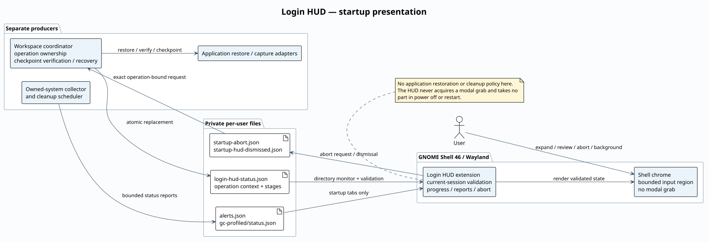

# Architecture

Login HUD is the startup presentation layer. Workspace-state owns
operation lifecycle, restoration, checkpoint verification, and recovery; the
cleanup scheduler and incident collector own their independent reports.



[Editable PlantUML source](architecture.puml). Regenerate with:

```sh
plantuml -tsvg -nometadata docs/architecture.puml
```

## Presentation boundary

The extension watches the private status directory, so atomic file replacement
is observed. It validates the document before installing visible Shell chrome.
An enable epoch and monotonically increasing load serial reject callbacks from
an old enable or superseded read. Current-session identity prevents an old
login's report from becoming current UI.

Startup uses ordinary Shell chrome. Only the panel participates in pointer
input; it does not acquire a modal grab. The primary monitor's usable area and
scale determine the panel budget. Header, notices, and actions reserve space;
only the job list scrolls. Stage grouping and progress normalization are pure
functions exercised by the Node unit tests.

Important-system and cleanup reports are independent inputs. They refresh their
views without opening a hidden HUD or overriding startup eligibility. The HUD
cannot turn a missing report into a healthy result. Cleanup reports are passive;
incident acknowledgment is a fixed validated command rather than content-supplied
shell execution.

## Shutdown

The HUD takes no part in power off or restart. It does not touch GNOME's
end-session dialog, write shutdown markers, or read shutdown evidence, so the
native Power Off and Restart actions run exactly as GNOME provides them. A
status document whose `mode` is not `startup` is ignored: nothing is shown and
nothing is written.

## Source map

| File | Responsibility |
| --- | --- |
| `extension.js` | GNOME lifecycle, file watches, startup operation ownership, startup controls, and read-only diagnostics. |
| `reports.js` | Pure status, alert, cleanup, normalization, aggregation, and presentation helpers. |
| `hudView.js` | `LoginHud` St.Widget presentation class and rendering callbacks. |
| `stylesheet.css` | Panel, rows, progress indicators, states, actions, and tabs. |
| `metadata.json` | UUID, supported Shell version, and extension version. |
| `buildInfo.js` | Import-time build identity stamped into release artifacts. |
| `tests/*.mjs` | Pure logic, layout, lifecycle, and startup regressions. |
| `scripts/capture-docs.py`, `scripts/screenshot-fixture.js` | Opt-in disposable compositor and synthetic screenshot scenarios; excluded from the extension bundle. |

The [file protocol](protocol.md) defines integration fields. Screenshots validate
actual rendering, while the unit tests exercise startup and failure paths;
neither replaces a coordinated activation test on the target GNOME version.
The [testing guide](testing.md) records the coverage and its limits.
